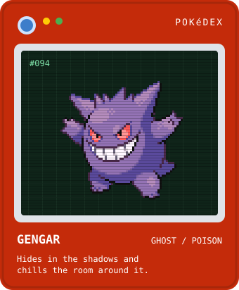
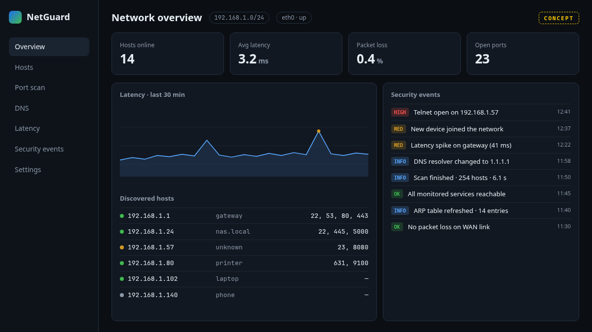
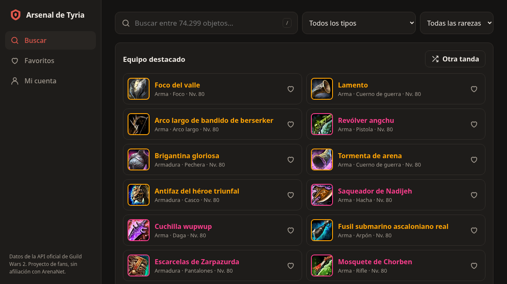
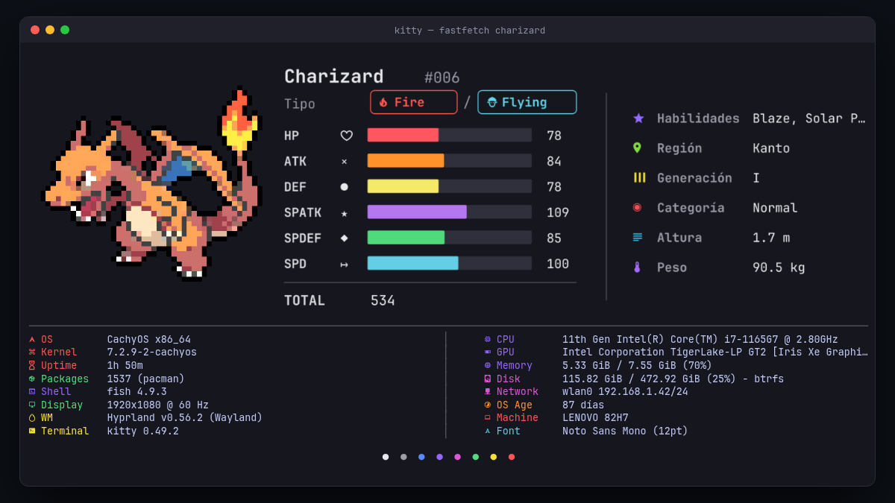
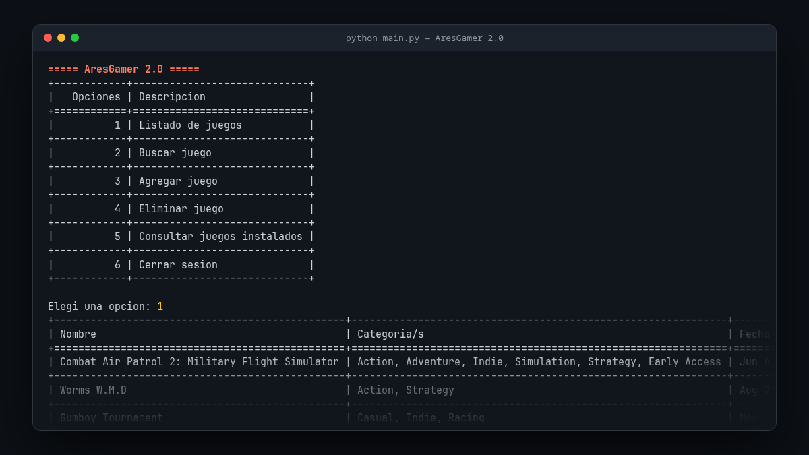

## 🎯 About Me



```python
trainer = {
    "name":     "Agustín Lamendola",
    "region":   "Buenos Aires, AR",
    "class":    "Software Development Student",
    "type":     ["Backend", "Networking"],
    "moves":    ["Python", "FastAPI", "SQL", "Linux", "Bash"],
    "training": [
        "Network Programming",
        "Linux Administration",
        "Cybersecurity Fundamentals",
    ],
    "evolution": "Backend → Infrastructure → Cybersecurity",
}
```

I learn by building: network tools, backend services and the occasional terminal tweak. Each project in my Pokédex below covers something I wanted to understand properly.

<br clear="right">

## 🤝 Connect

<p>
  <a href="https://ar.linkedin.com/in/agustin-lamendola"></a>
  <a href="https://but0o.github.io/Porfolio/"></a>
  <a href="mailto:agustinleonardola@gmail.com"></a>
</p>

## ⚡ Tech Stack

<p>
  
</p>

**Networking:**
`TCP/IP` `IPv4 / IPv6` `Subnetting & CIDR` `TCP / UDP` `ICMP` `ARP` `DNS` `Sockets` `Cisco Packet Tracer`

## 📟 Pokédex · Featured Projects

<table>
  <tr>
    <td width="50%" valign="top">
      <a href="https://github.com/But0o/NetGuard"></a>
      <br><sub><code>#001</code></sub> <b><a href="https://github.com/But0o/NetGuard">NetGuard</a></b>
      <br><sub>Network discovery and security monitor. My main project, built stage by stage. <i>Image: concept of the final dashboard.</i></sub>
      <br><code>Python</code> <code>Sockets</code> <code>FastAPI</code>
    </td>
    <td width="50%" valign="top">
      <a href="https://github.com/But0o/Gw2Web"></a>
      <br><sub><code>#002</code></sub> <b><a href="https://github.com/But0o/Gw2Web">Arsenal de Tyria</a></b> · <a href="https://but0o.github.io/Gw2Web/">live</a>
      <br><sub>Guild Wars 2 item browser. A daily GitHub Actions job builds a static index, so search runs locally over ~74k items.</sub>
      <br><code>TypeScript</code> <code>React</code> <code>PWA</code>
    </td>
  </tr>
  <tr>
    <td width="50%" valign="top">
      <a href="https://github.com/But0o/pokemon-fastfetch"></a>
      <br><sub><code>#003</code></sub> <b><a href="https://github.com/But0o/pokemon-fastfetch">Pokémon Fastfetch</a></b>
      <br><sub>Offline Pokémon dashboard for Kitty: a random Pokémon with its stats next to your system info. Cached and tested in CI.</sub>
      <br><code>Bash</code> <code>ImageMagick</code> <code>Kitty</code>
    </td>
    <td width="50%" valign="top">
      <a href="https://github.com/But0o/SkyDefence"></a>
      <br><sub><code>#004</code></sub> <b><a href="https://github.com/But0o/SkyDefence">SkyDefence</a></b>
      <br><sub>Arcade space defence game built as a university team to practice OOP and software design.</sub>
      <br><code>Java</code> <code>OOP</code>
    </td>
  </tr>
  <tr>
    <td colspan="2" align="center">
      <table><tr><td width="50%">
      <a href="https://github.com/But0o/AresGamer_2.0"></a>
      <br><sub><code>#005</code></sub> <b><a href="https://github.com/But0o/AresGamer_2.0">AresGamer 2.0</a></b>
      <br><sub>Offline game and user manager for a gaming center, with admin and PC roles. University team project.</sub>
      <br><code>Python</code> <code>JSON</code> <code>Tabulate</code>
      </td></tr></table>
    </td>
  </tr>
</table>

## 📊 GitHub Stats

<p>
  <picture>
    <source media="(prefers-color-scheme: dark)" srcset="https://github-readme-stats.vercel.app/api?username=But0o&show_icons=true&hide_border=true&bg_color=161b22&title_color=ff6b4a&icon_color=ffcb05&text_color=c9d1d9&rank_icon=github">
    
  </picture>
  <picture>
    <source media="(prefers-color-scheme: dark)" srcset="https://github-readme-stats.vercel.app/api/top-langs/?username=But0o&layout=compact&langs_count=6&hide_border=true&bg_color=161b22&title_color=ff6b4a&text_color=c9d1d9">
    
  </picture>
</p>

---

<p align="center"><sub>Always learning. Always building. Gotta ship 'em all.</sub></p>
